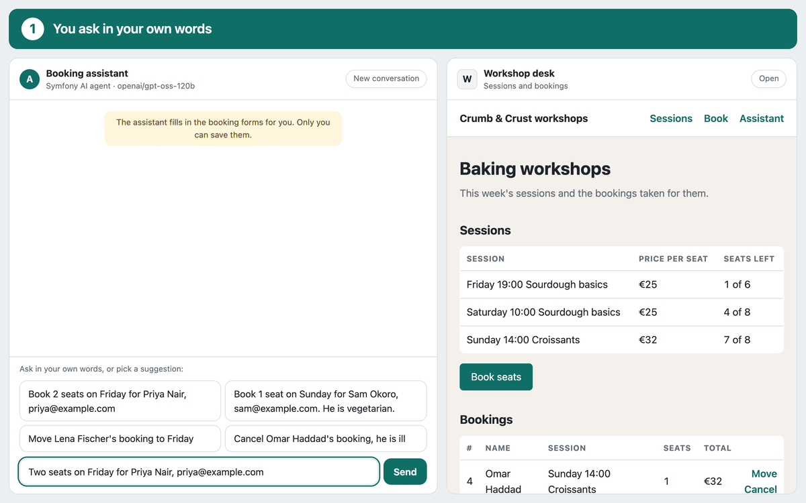

# FormBridge bundle

FormBridge exposes Symfony forms as MCP tools, as forms a person completes inside the conversation
(MCP Apps), and as tools of Symfony AI agents. An agent fills a form in and gets the form's own
validation back; none of the tools an agent is given can save. Saving requires the form shown to the
person or the review page.



```php
use FormBridge\Attribute\AsFormTool;

#[AsFormTool(
    name: 'create_booking',
    form: BookingType::class,
    description: 'Book seats for one person in a workshop session.',
    submitLabel: 'Book',
)]
final class CreateBookingHandler
{
    public function __invoke(BookingRequest $request): Booking
    {
        // Runs when a valid form was submitted. To refuse after all, throw a
        // ValidationFailedException before writing anything.
    }
}
```

## How it works


## Installation

```bash
composer require formbridge/formbridge-bundle
```

## Requirements

PHP 8.2+, Symfony 7.4+ with Form, Validator, Twig, Lock and CSRF protection, `symfony/mcp-bundle`
1.0 (beta) and `mcp/sdk` 0.9. `symfony/ai-agent`, `symfony/ai-platform` and `symfony/rate-limiter`
are optional.

## Documentation

[docs/index.md](docs/index.md) covers installation, configuration, routes, how saving is guarded,
events, extension points, translations, the supported field types and the limitations.

## Tests

```bash
composer update
vendor/bin/phpunit
```

The suite runs against a small application in `tests/App`, on PHP 8.2 with Symfony 7.4 and on
PHP 8.4 with Symfony 8.1.

## License

MIT, see [LICENSE](LICENSE).
